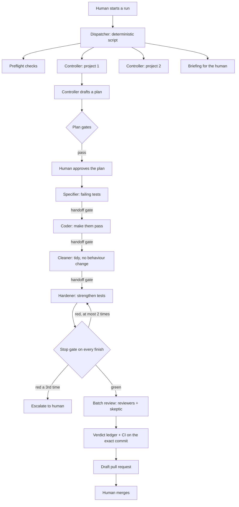

# Flow and roles

## The shape

The stop gate is drawn once but fires for **every** role: each role has its own set of gates
that must be green before it may finish.

## A run, step by step

1. **The human starts a run** with one command. A run ends when the queue is empty, the budget
   is spent, or a usage limit stops it. (A schedule can be added later without changing the
   design.)
2. **Preflight** (script, fails closed): credentials present, tools installed, project paths
   exist, working copies clean, dependencies installed. A failure stops that project with a
   reason in the briefing.
3. **Read the human's decisions** from the last briefing: approved plans become buildable,
   rejected plans go back with the human's note, accepted lessons are applied, accepted
   proposals become tickets.
4. **Fill slots:** at most a fixed number of controllers run at once (2 in the reference build).
5. **Each controller** handles a small, fixed number of tickets per run (2 in the reference
   build).
6. **When all controllers are done:** analyse the run's observations into lessons, then write the
   briefing.

On a usage-limit error: clean stop, the ticket goes back to the queue, and the run resumes after
the limit resets if it is still running.

## Ticket states

`ready-for-agent → planned → claimed → ready-for-review → done`

| Transition | Who | Tier |
|---|---|---|
| ready-for-agent → planned | Controller drafts a plan; the human approves it | 2 |
| planned → claimed | Controller, written before work starts | 3 |
| claimed → ready-for-review | Controller, after review and the ledger entry | 3 |
| claimed → planned | Controller, when a ticket is abandoned or escalated, with a report | 3 |
| ready-for-review → done | The human only | 4 |

## Roles

No role grades its own work, and each role **owns one set of gates**. Roles are short-lived:
each gets a fresh context, does one job and hands off. This keeps context small, which matters
even more on a local model.

| Role | Does | Must not | Owns the gate(s) |
|---|---|---|---|
| **Dispatcher** | Starts and supervises a run: preflight, slots, queue, caps, retries, watchers, the briefing. A plain script, no model | Make judgement calls | Preflight, concurrency cap, retry table, budget, verdict ledger, PR state machine |
| **Controller** | One per project. Picks work, drafts plans, writes each role's brief, routes handoffs, decides on escalation | Write code | Plan gates (before a plan reaches the human) |
| **Specifier** | Turns the plan's behaviour list into failing tests, in a new-tests area only | Write production code | **Red check**: the new tests must fail on the code before the change |
| **Coder** | Makes those tests pass, test-first, one behaviour at a time | Delete or weaken tests | Four checks (lint, typecheck, tests, build) + test-deletion guard |
| **Cleaner** | Refactors the change without changing behaviour; edits production code only | Change tests or behaviour | Four checks, test-deletion, duplication, import boundaries |
| **Hardener** | Adds tests until every mutant on the touched code is killed; adds property tests on pure modules | Change production code | Four checks, test-deletion, test strength (complexity-times-coverage score and mutation) |
| **Reviewers** | Read-only, fresh context each. Two axes: *standards* (code quality) and *spec* (does it do what the ticket says). One reviewer should be a **different model family** | Edit anything | Review schema (output must match a strict JSON shape) |
| **Skeptic** | Read-only. Tries to refute one high-severity finding with evidence | Edit anything | Refutation shape; unreadable output = not refuted |

## Handoffs

What passes between steps is always a **file or a commit**, never the conversation.

| From → to | What is handed over | Checked by |
|---|---|---|
| Human → controller | Ticket with acceptance criteria; standing project directives | Plan gates read both |
| Controller → human | Plan file (fixed sections, behaviour list with real test code and the expected failure of each, criteria-to-behaviour map, risks, needs-human) | Plan gates |
| Controller → role | A brief with nine fields: goal, scope, context, acceptance, verify, timebox, forbidden, report, standing orders; plus the project directives | (template) |
| Role → role | A handoff draft: type, recipient, priority, task name, commit (or a one-line note) | **Handoff gate**: the gate, not the agent, writes the final handoff file |
| Role → controller | A three-line report for the briefing; the gate JSON results | Stop gate |
| Reviewer → controller | One JSON object `{findings: [...]}` | Review schema gate |
| Skeptic → controller | `{refuted: boolean, evidence: string}` | Refutation check |
| Controller → human | Draft pull request; ledger entry for the exact commit; briefing | CI-on-commit gate, ledger |

Agents never write the canonical handoff file themselves: they write a small draft, and the
handoff gate validates it and generates the identifiers, timestamps and full commit hash.

## Review, in order

1. **Pre-flight:** pin the merge-base; fail early on a bad reference or an empty diff.
2. **Reviewers in parallel**, fresh context, read-only. If the second model family is
   unavailable, a stand-in reviewer from the main family takes its place and the briefing says
   so.
3. **Schema gate** on each reviewer's output. A crashed reviewer counts as blocking.
4. **Skeptic** on each high or critical finding. Findings that are not refuted block.
5. **Triage:** fix, decline with a reason, or escalate. At most 2 fix rounds, each through the
   stop gate again.
6. **Commit, ledger, pull request:** record the verdict for the exact commit, push a feature
   branch, open a **draft** pull request, and require CI green on that commit.

Whether review runs inside every run or only on request is a per-project choice
(to confirm after the pilot).

## The flow as the tools run it

The package's `flow/` folder is the flow the reference build ran its own tickets with, for any
harness and any host: `node flow/cli.ts <tool> [args]` in the repo, with `config/flow.json` read
from it. No tool assumes a model, an agent CLI or a host: the model families and their commands,
the host and the branch names are configuration.

| Field of `config/flow.json` | Default | What it sets |
|---|---|---|
| `integrationBranch` | `main` | The branch tickets merge into, merged into every open ticket branch after each merge |
| `buildCap` | `3` | The most builds in flight, every family counted together |
| `owner` | `the owner` | Whose yes a merge needs; named in the merge commit |
| `ticketFolder` | `docs/tickets` | The ticket files, `<NN-name>.md` |
| `branchPrefix` | `ticket/` | A ticket branch is this prefix and the ticket file's name |
| `remote` | `origin` | The remote the branches live on |
| `stateDir` | `state/flow` | The flow's state: the gate queue, the yeses, the reviews, the logs and the records |
| `worktreeDir` | `.worktrees` | The flow's own worktrees: the gate's, each build's, the integration branch's |
| `host` | `{"host": "github"}` | `adapters/host`: `github`, or `azure-devops` with `organization`, `project` and `repository` (the token in `AZURE_DEVOPS_PAT`) |
| `families` | none | Each model family: `name`, `build` and `review` shell commands, `timeoutMs` (an hour) |
| `gate` | `npm run gate -- --base {base} --merge {branch}` | The merge gate's commands, in order |
| `checks` | `npx tsc --noEmit`, `npx vitest run` | What a build round must pass before handover |
| `typecheck` | `npx tsc --noEmit` | The check on an open branch after the base is merged into it |
| `afterMerge` | no commands, no files | Commands run in a merge before its commit, and the files they write that it commits |
| `decisions` | `state/decisions.json` | The owner's decisions on waiting items (`flow/decisions.ts`'s JSON list) |
| `pendingFolder` | `state/approvals/pending` | Where the learning loop files waiting lessons, `lesson/<run>-<n>.json` |
| `directivesFile` | `AGENTS.md` | Where an accepted directive lesson is appended |
| `skillsFolder` | `skills` | The skills an accepted skill lesson goes in, `<skill>/SKILL.md` (the coder's when it names none) |

A family's command gets the round's brief on stdin and these placeholders: `{prompt}` (the
brief's file), `{worktree}`, `{branch}`, `{base}`, `{ticket}`, `{head}` and `{out}` (where a review
may write its JSON); the gate's commands get `{base}` and `{branch}`. A value never enters the
command line: `{name}` becomes the variable `FLOW_NAME`, referenced in double quotes (`"$FLOW_NAME"`
for sh, `"%FLOW_NAME%"` for cmd on Windows), so a path or a branch reaches the program as one
literal argument whatever it holds. Write placeholders bare, never inside quotes of your own. cmd
cannot hold a double quote or a line break inside its quotes, so on Windows a value with one is
refused, and a value's trailing backslashes are doubled for the program's argument parser. Claude
Code, Codex, opencode or a local model behind any CLI are one line each, for example
`"review": "opencode run --file {prompt}"`.

1. **Build** (`flow build <ticket> --family <name>`): takes a place under the build cap, works in
   a worktree of its own with the base merged in, runs the family's build command, then every
   `checks` command; only when all pass does it write `Builder: <family>` and `Round: <n>` into
   the ticket's Result and push the ticket branch. `flow in-flight start|end` records a build the
   flow did not start (a cloud session, a person).
2. **Done** (`flow done`): the ticket branches whose ticket file has a `## Result` section.
3. **Gate** (`flow gate-queue add <branch>`, then `run`): one gate at a time, under a lock in the
   state folder under git's common directory (one lock for every worktree of the repo), in the
   flow's gate worktree: the base and the branch merged without a commit, then each `gate`
   command; green, red at the failing command, or a conflict.
4. **Review** (`flow review <ticket>`): a configured family **other than** the one in the last
   `Builder:` line reviews the exact head on the remote, the change since its last review; its
   JSON must match the review schema (`gates/review-schema`). The builder's own family is
   refused. Fix rounds go back to step 1 and are reviewed again.
5. **Merge** (`flow merge --consent <ticket> "<words>"`, `flow merge --review <ticket> <family>
   <findings.json>`, then `flow merge <ticket>`): only on the head the owner said yes to, the
   gate passed and another family reviewed with every finding fixed or declined with a reason,
   and only while the base is the one the gate ran on. The merge runs `afterMerge`, pushes the
   base, and merges it into every open ticket branch no build is writing to, each typechecked in
   its own worktree and pushed only when clean; a conflict leaves the branch as it was, listed.
6. **Status** (`flow status`): every open build, the gate queue and each latest gate, the builds
   in flight by family against the cap, and a warning above it.
7. **Pull request and CI** (`flow pr`, `flow watch-pr`, `flow ledger`): the draft PR against the
   integration branch, the CI watch on one exact commit and the SHA ledger, on GitHub or Azure
   DevOps through `adapters/host`. On Azure DevOps the watch reads the pipeline runs and the
   branch policies of the PR's exact head.
8. **Lessons** (`flow apply-lessons`): each lesson the owner accepted in `decisions`, and only
   those, is written where the owner's decision (else the lesson) says, with its approval id
   (the item and the moment it was accepted), never twice: a section in `directivesFile`, a rule
   in a skill under `skillsFolder`, or a gate ticket draft in `<stateDir>/lessons/gate/`. A lesson
   that does not check out (not waiting, broken, a skill that is not there) is refused and
   reported, exit 1, with nothing written for it.

Every build and review round, and each branch the base was merged into, is a record in
`<stateDir>/observations.jsonl` for the evaluation (`flow/evaluate.ts`) to count.

## Optional extras in the reference build

These depend on the projects and hosting involved; treat them as patterns, not requirements.

- **Incident watcher:** a script loop that polls hosting and database status during a run and
  files incidents into the queue. One written exception to "reads free, writes ask": an
  automatic rollback of the production deployment to the previous one, only when a code rule
  with fixed thresholds fires (error count and rate, compared with the previous deploy), at most
  once per 24 hours, always logged and reported.
- **Upstream watcher:** weekly, compare a list of public upstream repositories against their
  last-seen commit; no change means no model call. Changes are classified (new gate, changed
  gate, flow idea, irrelevant) and the top few become tier-2 proposals. Never applied
  automatically; a licence check runs before anything is borrowed.
